# 实践课1：Pi Agent 安装与使用 zhangjiayao

## 一、任务完成情况

| 序号 | 任务 | 完成情况 | 截图 | 对应任务书验收项 |
|---|---|---|---|---|
| 1 | 本地安装并启动 Pi | 完成 | S1 | S1 |
| 2 | 配置模型并完成一次会话 | 完成 | S2 | S2 |
| 3 | 切换模型与模型思考级别 | 完成 | S3.1–S3.4 | S3 |
| 4A | 使用 @ 引用代码文件 | 完成 | S4.1-A、S4.2-A | S4 |
| 4B | 粘贴小图片并测试 | 完成（图片以文件路径传入，PIL 辅助识别） | S4.3-B–S4.5-B | S5 |
| 5 | 安装并试用 Pi 插件 | 完成（pi-web-access） | S5.1、S5.2 | S6 |
| 6 | 让 AI 安装 PPT Skill（选做） | 完成安装、发现与调用 | S6.1–S6.4 | S7、S8 |

## 二、任务一：本地安装并启动 Pi

### 2.1 安装

安装命令来自 Pi 官方仓库 README（https://github.com/earendil-works/pi）。在 PowerShell 中执行：

```powershell
powershell -c "irm https://pi.dev/install.ps1 | iex"
```

安装完成后关闭旧终端并重新打开，在练习目录中启动：

```powershell
mkdir pi-test
cd pi-test
pi
```

### 2.2 启动结果

- 客户端版本：Pi v1.5.0；
- 当前工作目录：`~\studytools\data\practice\pi-test`（窗口标题为 `π · pi-test`）；
- 底部状态栏显示当前模型 `(deepseek-anthropic) deepseek-flash • high`。截图 S1 记录时模型已完成配置；首次启动若显示“No models available”，按任务二配置后即可出现该状态。

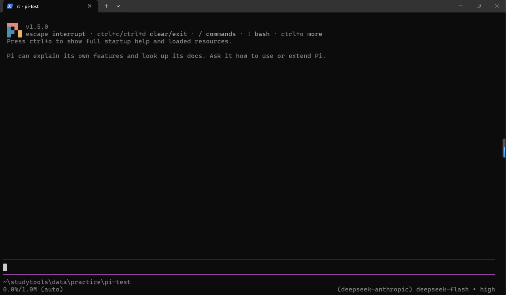

*S1：Pi v1.5.0 启动成功，底部显示工作目录与当前模型。*

## 三、任务二：配置模型并完成一次会话

采用 **API Key** 方式接入 DeepSeek：在 Pi 中输入 `/login`，选择 **Sign in with an API key**，搜索并选择 DeepSeek 提供商，粘贴在 DeepSeek API Platform 创建的密钥后提交。密钥仅保存在本机 Pi 配置中，本报告不展示密钥内容，也不提交 `auth.json`。

配置后发送提示词：

```text
你好
```

模型正常返回中文问候，并说明当前工作目录为 `C:\Users\Lenovo\studytools\data\practice\pi-test`；底部状态栏同时显示提供商、模型和思考级别。

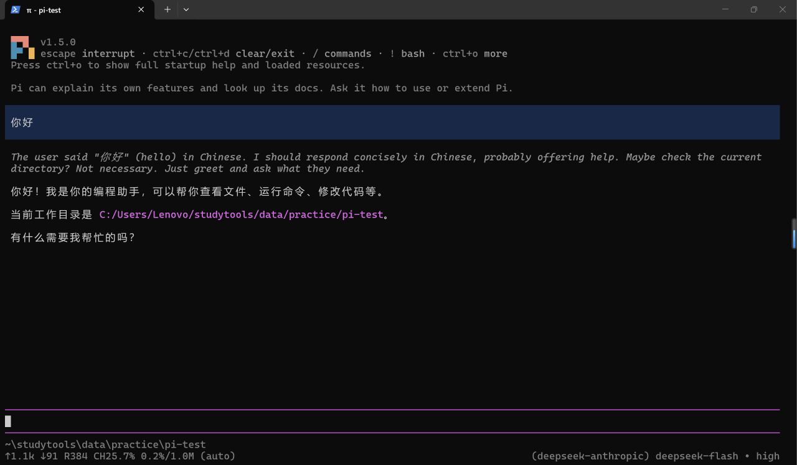

*S2：配置成功后完成的一次会话，包含用户提示词、模型回复和当前模型信息（deepseek-flash • high）。*

## 四、任务三：切换模型与思考级别

### 4.1 切换模型

切换前：`deepseek-flash`（DeepSeek V4.1 Flash，默认模型），思考级别 `high`。输入 `/model` 打开模型选择器，界面提示只显示已配置提供商的模型，列表共 19 个；选择 `deepseek-v4-pro`（DeepSeek V4 Pro）并确认。

切换后：底部状态栏变为 `(deepseek-anthropic) deepseek-v4-pro • high`；继续会话并追问当前模型，回复中明确给出 `Model: deepseek-v4-pro`，说明切换已生效且对话仍正常。

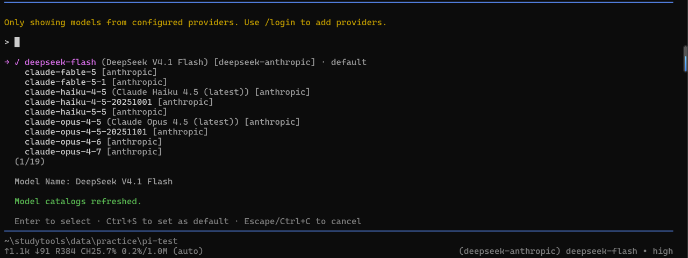

*S3.1：模型选择器。切换前当前默认模型为 deepseek-flash，列表显示已配置提供商的 19 个模型。*

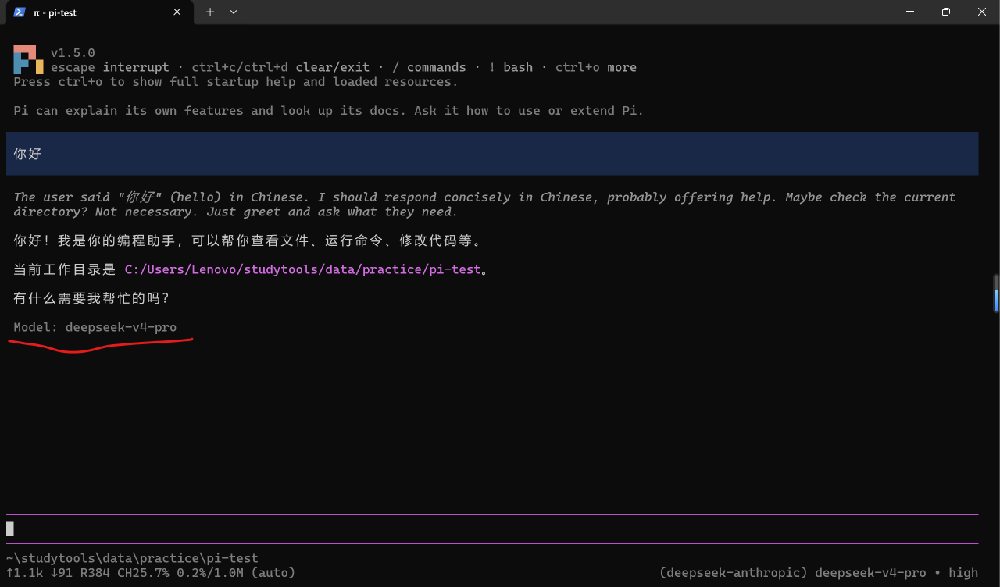

*S3.2：切换后会话正常，回复中显示 Model: deepseek-v4-pro，底部状态为 deepseek-v4-pro • high（红色下划线为本人标注）。*

### 4.2 切换思考级别

输入 `/thinking`（或 Shift+Tab 循环）打开思考级别选择器，可选 `off`、`minimal`、`low`、`medium`、`high` 五档，默认 `high`。本次将思考级别下调，选择器截图记录档位为 `minimal`，最终确认并保持在 `low`；底部状态栏同步显示 `deepseek-v4-pro • low`。

| 状态 | 模型 | 思考级别 |
|---|---|---|
| 切换前 | deepseek-flash | high |
| 切换模型后 | deepseek-v4-pro | high |
| 调整思考级别后 | deepseek-v4-pro | low |

选择依据：本次任务只是验证切换与基础会话，使用较低思考级别可以减少等待时间和 token 用量；遇到跨文件分析、方案设计或复杂排错时，再切回 `medium` / `high`。较高思考级别并不保证结果一定更好，会增加响应时间与用量。

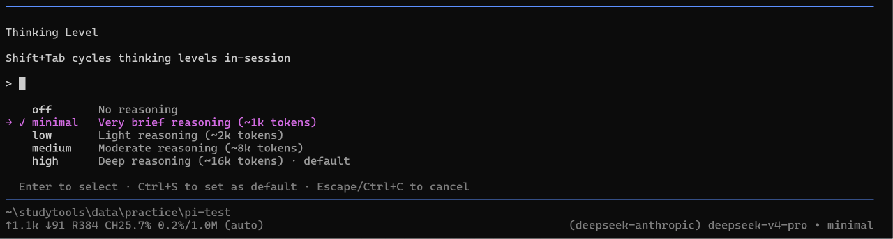

*S3.3：思考级别选择器（off / minimal / low / medium / high），操作时停留于 minimal，底部同步显示 deepseek-v4-pro • minimal。*

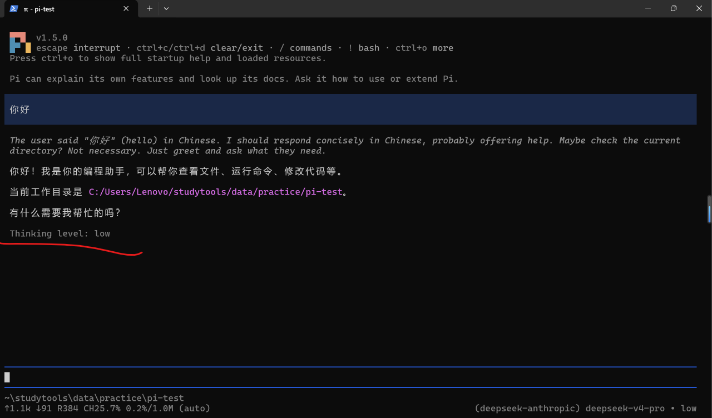

*S3.4：最终确认思考级别为 low，底部显示 deepseek-v4-pro • low（红线下划线处为 Thinking level: low）。*

## 五、任务四：引用代码文件并粘贴小图片

### 5.1 A：使用 @ 引用 hello.py

在练习目录创建 `hello.py`：

```python
def add(a, b):
    return a + b

print(add(2, 3))
```

在 Pi 输入框中输入 `@`，从候选列表选择 `hello.py`，发送：

```text
@hello.py 请解释 @hello.py 的功能，说明运行后输出什么。只解释，不修改文件。
```

Pi 调用 `read hello.py` 读取文件后解释：`add` 接收两个参数并返回它们的和；`print(add(2, 3))` 调用函数并打印结果，运行后输出 `5`。回复与预期一致，且未修改文件。

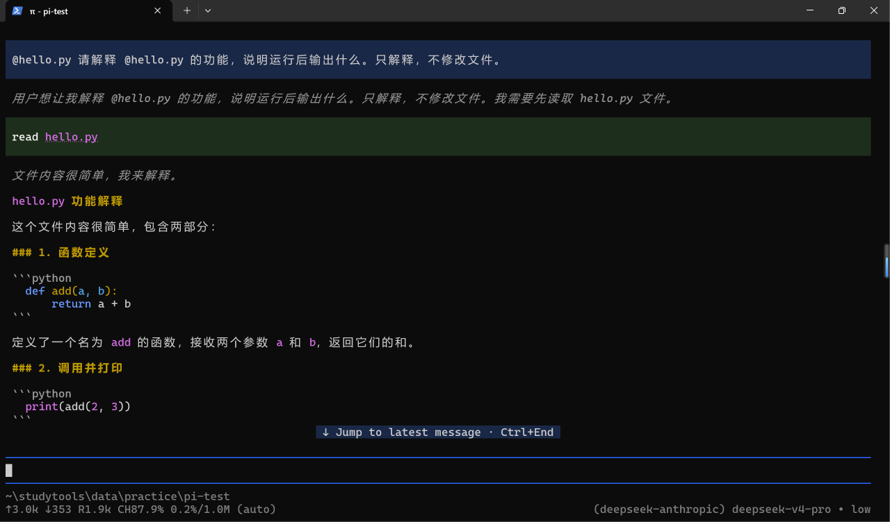

*S4.1-A：提示词中通过 @ 选中 hello.py，Pi 调用 read 工具读取文件并开始解释。*

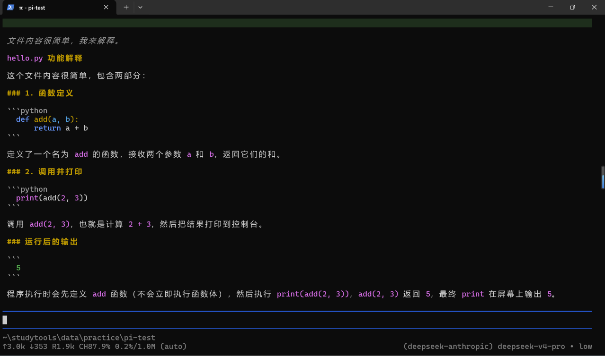

*S4.2-A：解释的后续部分，明确指出 print(add(2, 3)) 的运行输出为 5。*

### 5.2 B：粘贴小图片测试

准备一张 200×200 像素的测试图片：白色背景、一个蓝色实心正方形、右侧一个黑色数字 7。先截取图片内容到剪贴板，在 Pi 输入区使用 Alt+V（当前版本也支持 Ctrl+V）粘贴，输入提示词并发送：

```text
请描述图片中的颜色、形状和数字。
```

本次会话使用的模型为 `deepseek-flash`。截图中的模型回复说明当前模型不支持直接图像输入，因此 Pi 把图片文件 `test_image.png` 的路径传入会话，模型改用 Python/PIL 读取像素数据进行分析。识别结果：

- 尺寸与格式：200×200 像素，RGB；
- 背景：纯白色，约占 74%；
- 形状：实心蓝色正方形，RGB = (0, 0, 255)，约 101×101 像素，位于画面中部偏左上；
- 数字：黑色数字 7，位于蓝色正方形右侧，垂直方向大致居中；
- 一句话总结：白底上有一个蓝色实心正方形，其右侧有一个黑色数字 7，垂直方向居中。

识别结果与原图一致。需要说明的是，本次未能形成直接的视觉附件，模型是通过 PIL 读取像素完成识别的；若按任务书要求严格验证多模态图片输入，应切换到明确支持图像输入的提供商/模型后重试。

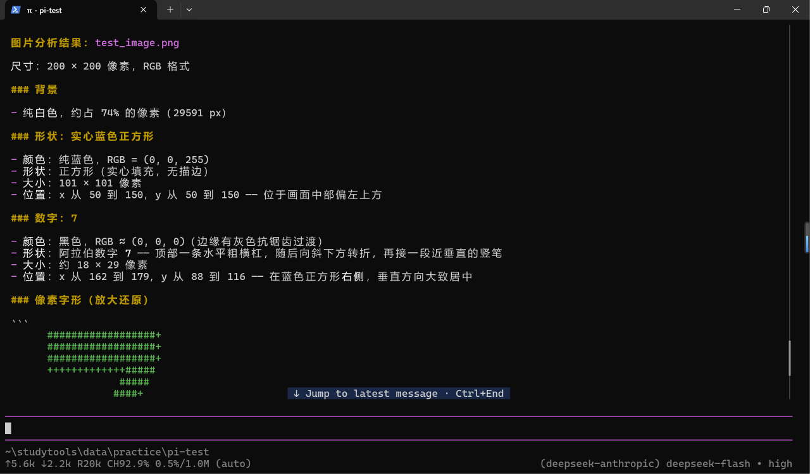

*S4.3-B：图片分析结果（上），包含尺寸、背景和蓝色正方形的位置与 RGB 值。*

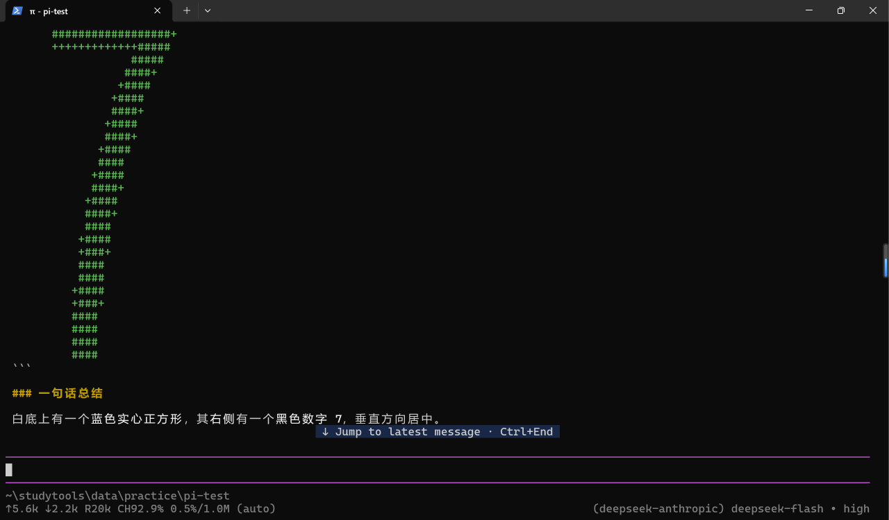

*S4.4-B：图片分析结果（下），包含数字 7 的定位、ASCII 像素字形和一句话总结。*

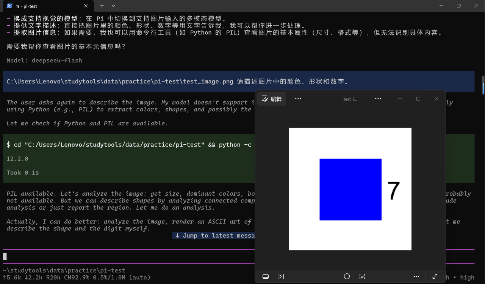

*S4.5-B：会话中输入区显示 test_image.png 路径，右侧同屏插入原始测试图片，便于核对识别结果；红色下划线标注当前模型为 deepseek-flash。*


*图 4B-1：原始测试图片（200×200，白底蓝色正方形 + 黑色数字 7）。*

## 六、任务五：安装并使用插件 pi-web-access

从 Pi Packages（https://pi.dev/packages）选择插件 **pi-web-access**，其说明提供网页抓取/访问工具（新增 `fetch` 等工具）。记录如下：

| 项目 | 内容 |
|---|---|
| 插件名称 | pi-web-access |
| 来源 | https://pi.dev/packages 中的 npm 包 `pi-web-access` |
| 安装命令 | `pi install npm:pi-web-access` |
| 作用 | 为 Pi 增加网页抓取等网络访问工具 |
| 所需配置 | 无需额外密钥（本次直接可用） |

在 PowerShell 中执行个人级安装：

```powershell
pi install npm:pi-web-access
```

安装后本地扩展目录 `~/.pi/agent/npm/package.json` 中记录依赖：

```json
{
  "name": "pi-extensions",
  "private": true,
  "dependencies": {
    "pi-web-access": "^0.47.0"
  }
}
```

退出原会话后重新执行 `pi`，启动界面 `[Extensions]` 区域显示 `pi-web-access:dist`，说明插件已加载。随后试用最小功能，发送：

```text
请获取 https://example.com 的页面标题
```

Pi 调用 `fetch https://example.com`，readable 模式因页面内容过短提取失败后自动改用 `raw` 模式，获取到 577 字符 HTML，并给出页面标题 `Example Domain`。

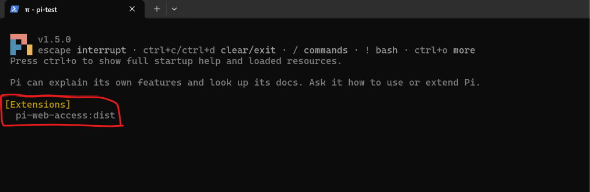

*S5.1：重新启动 Pi 后，[Extensions] 区域显示 pi-web-access:dist（红框标注）。*

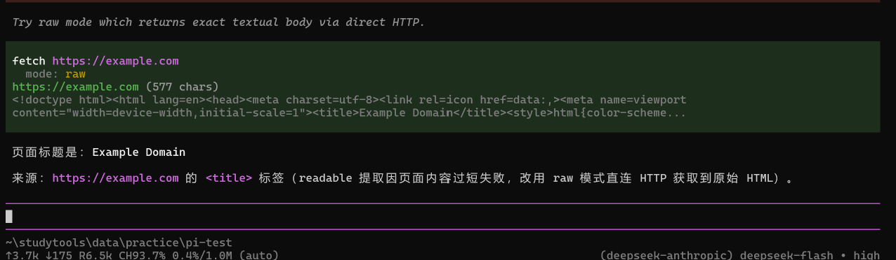

*S5.2：调用 fetch 获取 https://example.com，raw 模式返回 HTML，页面标题为 Example Domain。*

## 七、任务六（选做）：安装并调用 PPT Skill

### 7.1 安装

在练习目录启动 Pi，向 AI 发送提示词，要求从 `anthropics/skills` 仓库下载 `skills/pptx` 完整目录到当前项目的 `.pi/skills/pptx`，保留 `SKILL.md`、`LICENSE.txt` 和 `scripts` 等支持文件，记录源 commit，不修改其他项目、不自动安装依赖：

```text
请从 https://github.com/anthropics/skills 下载 skills/pptx 完整目录，安装到当前项目的 .pi/skills/pptx。保留 SKILL.md、LICENSE.txt 和 scripts 等支持文件，记录源 commit。只安装这个 Skill，不修改其他项目，不自动安装依赖；如目标已存在先说明情况。完成后列出目录结构。
```

安装结果：

- 安装目录：`C:\Users\Lenovo\studytools\data\practice\pi-test\.pi\skills\pptx`；
- 文件数：57 个（含本地新增的 `.source.json`）；
- 来源记录（`.source.json`）：仓库 `https://github.com/anthropics/skills`，路径 `skills/pptx`，分支 `main`，commit `2c5958ecac7cee2b583967a2c4981d0f4a75c579`（2026-11-06），许可证 Apache-2.0，未自动安装依赖。

目录结构（节选）：

```text
C:\Users\Lenovo\studytools\data\practice\pi-test\
  .pi\
    skills\
      pptx\
        .source.json
        SKILL.md
        LICENSE.txt
        scripts\
          __init__.py
          add_slide.py
          clean.py
          thumbnail.py
          office\
            __init__.py
            office.py
            validate.py
            helpers\
            validators\
            schemas\
```

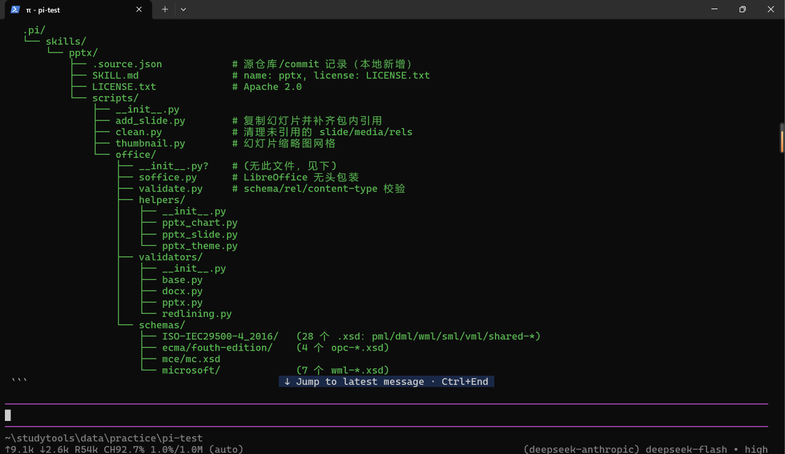

*S6.1：AI 返回的安装结果与目录结构，包含 SKILL.md、LICENSE.txt、scripts 及 office 子目录。*

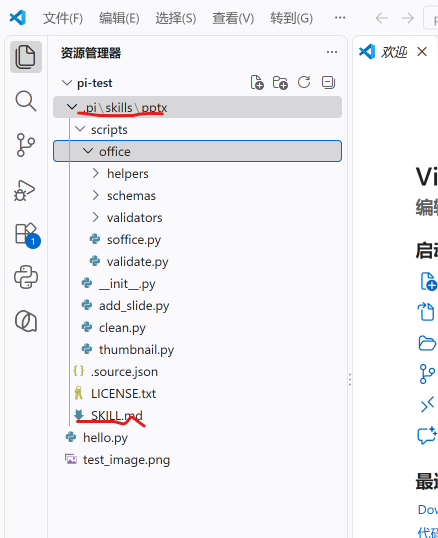

*S6.2：资源管理器中 `.pi > skills > pptx` 的实际目录，SKILL.md 与 scripts、office、helpers、schemas、validators 等文件均已保留（红色下划线为本人标注）。*

### 7.2 启动发现

完全退出原会话，在 `C:\Users\Lenovo\studytools\data\practice\pi-test` 中重新执行 `pi`，按 Ctrl+O 展开启动帮助与已加载资源：

```powershell
cd C:\Users\Lenovo\studytools\data\practice\pi-test
pi
```

`[Skills]` 区域显示项目级 Skill：`~\studytools\data\practice\pi-test\.pi\skills\pptx\SKILL.md`，说明 Pi 已从项目 `.pi/skills` 发现 pptx Skill。

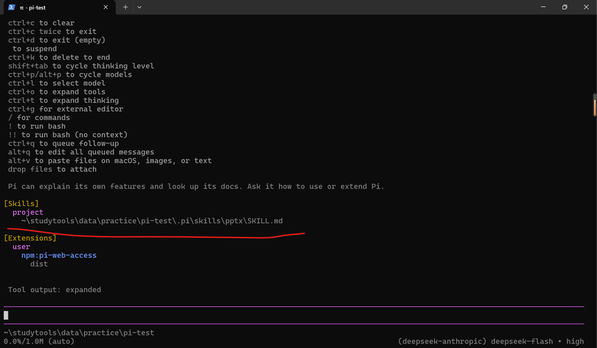

*S6.3：重新启动后 Ctrl+O 展开的 [Skills] 区域，项目级 pptx Skill 指向本次安装位置（红线下划线标注）。*

### 7.3 实际调用

输入显式调用命令：

```text
/skill:pptx 请说明这个 Skill 的名称、用途和所在目录，
```

Skill 返回：名称为 pptx，所在目录为 `C:\Users\Lenovo\studytools\data\practice\pi-test\.pi\skills\pptx`，并说明该 Skill 用于 `.pptx`/`.potx` 文件的创建、读取与编辑，列出 SKILL.md、scripts/、LICENSE.txt、.source.json 四项内容及三条使用路线（新建、编辑、读取）。

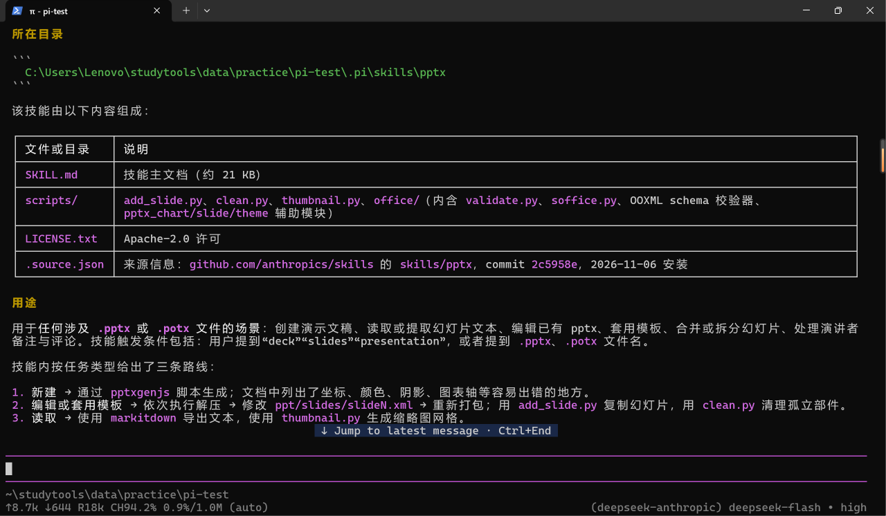

*S6.4：`/skill:pptx` 的调用结果，显示了 Skill 名称、所在目录、组成文件与用途。*

至此，安装成功、启动发现、实际调用三个层次均已完成；按任务书要求，生成 PPT 属于后续进阶项，本次未作为验收内容。`.source.json` 记录 `dependencies_installed: false`，说明本次仅安装 Skill 文件，未自动安装 Node.js/pptxgenjs、Python 等外部依赖。

## 八、问题与说明

1. **图片输入未形成视觉附件。** 本次图片测试会话使用 deepseek-flash，模型回复称不支持直接图像输入，Pi 将 `test_image.png` 的路径传入会话，模型改用 Python/PIL 读取像素完成识别，识别结果正确。若要严格满足“切换到明确支持图片输入的模型”的要求，建议使用 Anthropic 等支持视觉的提供商重试，并保存带图片附件的截图。
2. **插件安装输出。** 报告以本地 `~/.pi/agent/npm/package.json` 的依赖记录说明安装完成，以重启后的 `[Extensions]` 截图和一次 `fetch` 调用证明加载与可用；安装命令本身的终端输出未单独截图。
3. **密钥安全。** 报告中不包含 API Key、`auth.json` 或授权回调链接。

## 九、截图清单

| 截图 | 对应内容 |
|---|---|
| S1.png | 任务一：Pi 启动成功（版本、工作目录、当前模型） |
| S2.png | 任务二：配置模型后的首次会话 |
| S3.1.png | 任务三：切换前的模型选择器 |
| S3.2.png | 任务三：切换为 deepseek-v4-pro 后的状态 |
| S3.3.png | 任务三：思考级别选择器（minimal 档位） |
| S3.4.png | 任务三：思考级别最终为 low |
| S4.1-A.png | 任务四 A：@ 引用 hello.py 并读取 |
| S4.2-A.png | 任务四 A：解释输出 5 |
| S4.3-B.png | 任务四 B：图片分析结果（上） |
| S4.4-B.png | 任务四 B：图片分析结果（下） |
| S4.5-B.png | 任务四 B：原始图片同屏展示 |
| test_image.png | 任务四 B：原始测试小图片 |
| S5.1.png | 任务五：重启后 [Extensions] 加载 pi-web-access |
| S5.2.png | 任务五：fetch 调用获取页面标题 |
| S6.1.png | 任务六：Skill 目录结构 |
| S6.2.png | 任务六：资源管理器中的 Skill 文件夹 |
| S6.3.png | 任务六：重启后发现 pptx Skill |
| S6.4.png | 任务六：/skill:pptx 调用结果 |
