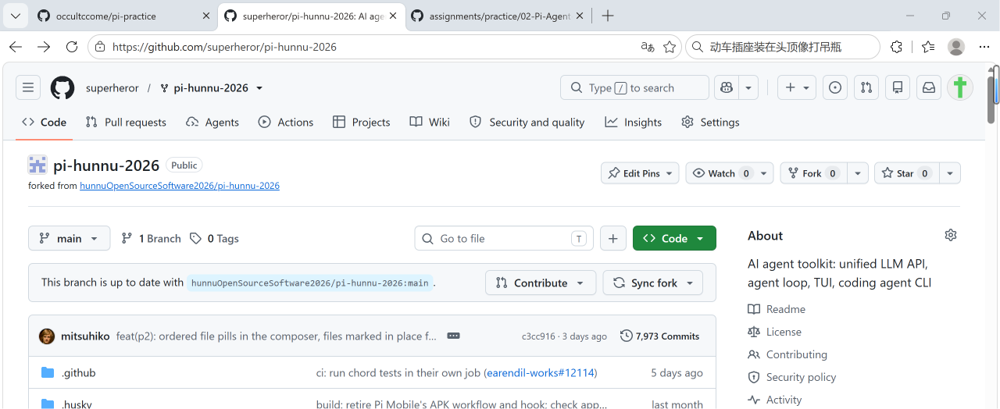
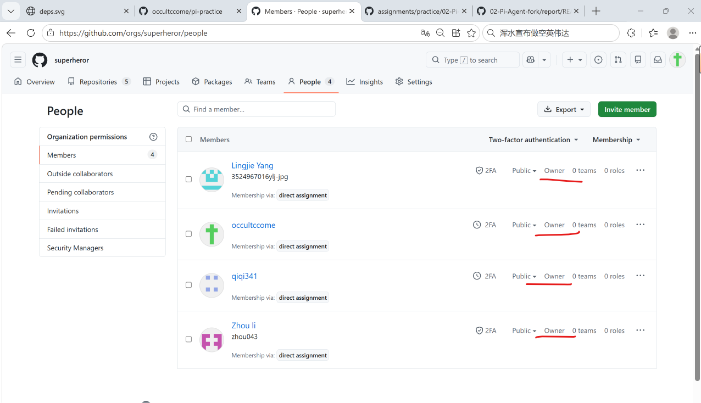
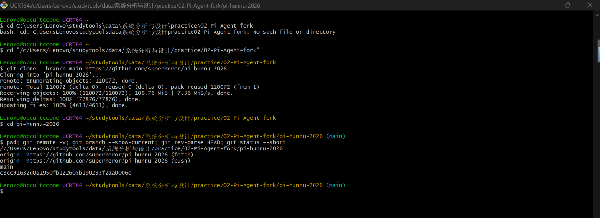
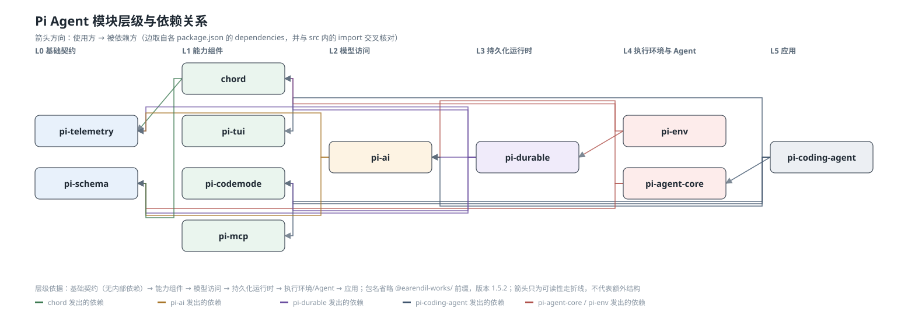

# 实践课2：组织建仓与源码分析（zhangjiayao）

## 基本信息
- GitHub 登录名：occultccome
## 作业链接
- 个人作业地址：https://github.com/occultccome/pi-practice/blob/main/02-Pi-Agent-fork-zhangjiayao.md
- 小组组织仓库：https://github.com/superheror/pi-hunnu-2026
- 实际 clone 地址：https://github.com/superheror/pi-hunnu-2026.git
- 提交编号：c3cc91632d0a1950fb122605b190233f2aa0006e

## 补充说明
无

## 一、建仓与克隆

小组仓库：`https://github.com/superheror/pi-hunnu-2026`（由课程仓库 fork 到小组组织，Owner 为组织账号）。


克隆命令（在 `practice/02-Pi-Agent-fork` 下执行）：

```bash
git clone https://github.com/superheror/pi-hunnu-2026
cd pi-hunnu-2026
```

S1 要求记录的四项信息，均在 `pi-hunnu-2026` 目录内取自本机终端：


## 二、分析方法与证据来源

1. 先看根 `package.json` 的 `scripts.build`，确定构建顺序与入口；
2. 遍历 `packages/*/package.json`，取 `name`、`scripts.build`、`dependencies`、`peerDependencies`、`devDependencies`，建立包名 → 目录映射；
3. 用 `src` 内的 `@earendil-works/*` import 交叉核对"声明的依赖是否真的被使用"（避免把只出现在注释里的包算成依赖）；
4. 查 `tsconfig.build.json` 与 `tsconfig.base.json`，确认产物形态。

## 三、模块分析表

| 子文件夹 | 代码主要实现什么功能 | 本模块 build 执行什么、生成什么 | 直接依赖哪些内部模块 | 依据文件或代码位置 |
|---|---|---|---|---|
| `telemetry` | 厂商中立的遥测契约：`TelemetryContext` / `TelemetrySpan` 回调式接口、指标采集、渲染与一致性测试工具 | `tsc -p tsconfig.build.json`，按 `tsconfig.base.json` 生成 `dist/` 下的 ES2024 模块、`.d.ts` 与 sourcemap | 无 | `packages/telemetry/package.json`（dependencies 为空）、`packages/telemetry/src/index.ts`、README 首段 |
| `schema` | JSON Schema 构建器与校验器：把 schema 编译成普通闭包，不使用 `eval`，零运行时依赖，可在严格 CSP 下工作 | `tsc -p tsconfig.build.json` → `dist/`（`.d.ts` 供其他包的类型推导） | 无 | `packages/schema/package.json`、`packages/schema/README.md`、`packages/schema/tsconfig.build.json` |
| `chord` | 跨进程对象与插件运行时：对象类型是契约（名称、参数、宿主、成员、版本），facet 是插件对某宿主的声明，插件热重载后对象继续存活 | `tsc -p tsconfig.build.json` → `dist/`，并有 27 个 `exports` 子路径（`./sqlite`、`./workers`、`./react`、`./tui` 等） | `pi-schema`、`pi-telemetry` | `packages/chord/package.json`；`src` 内 import schema 8 次、telemetry 27 次 |
| `tui` | 终端 UI 框架：差分渲染、同步输出、主屏/备用屏两套渲染器、布局、输入与剪贴板（含原生模块） | `tsc -p tsconfig.build.json` → `dist/`；原生剪贴板模块单独走 `build:native:darwin/linux/win32`，不在 `build` 内 | 无 | `packages/tui/package.json:7-14`、`packages/tui/native/*`、README 首段 |
| `codemode` | 在 QuickJS（编译为 WebAssembly）里运行模型写的 JavaScript，唯一能力是调用注入的工具；嵌套工具调用不进入模型上下文，只有脚本输出与返回值进入 | `tsc -p tsconfig.build.json` → `dist/`，另导出 `./declarations`、`./portable`、`./cloudflare`、`./worker` | 无 | `packages/codemode/package.json`、README 首段 |
| `mcp` | 独立 MCP 客户端：不依赖官方 SDK，提供 transport 中立的客户端核心、stdio 与 Streamable HTTP 传输、内存测试传输 | `tsc -p tsconfig.build.json` → `dist/` | 无 | `packages/mcp/package.json`、README 首段；`src` 内仅两处注释提到 pi-ai/pi-env，非真实依赖 |
| `ai` | 统一 LLM API：provider 集合、自动鉴权、token 与成本统计、上下文持久化与跨模型交接 | `generate-models`（`catalog/generate.ts --strict`）→ `check:model-data` → `tsc` → 把 `src/providers/data` 拷进 `dist/providers` | `pi-schema`、`pi-telemetry` | `packages/ai/package.json` scripts（build / build:offline）；`src` 内 import schema 8 次、telemetry 2 次 |
| `durable` | 持久化 agent harness：会话、模型回合、工具调用与自定义状态都先提交存储再展示；进程中途死亡可续跑 | `tsc -p tsconfig.build.json` → `dist/` | `chord`、`pi-ai`、`pi-codemode`、`pi-schema`、`pi-telemetry` | `packages/durable/package.json`；`src` 内 import chord 136 次、ai 28 次、codemode 7 次、schema 11 次、telemetry 8 次 |
| `env` | 远程执行环境：agent 的工具在另一台机器（通常经 SSH）执行，Durable 的 worker、存储与凭据留在本地；daemon 是 Rust 程序，TS 侧是客户端 | `tsc -p tsconfig.build.json` → `dist/` | `chord`、`pi-durable` | `packages/env/package.json`、README 首段；`src` 内 import durable 5 次、chord 3 次 |
| `agent` | 有状态 agent：回合循环、工具执行、事件流（包名 `pi-agent-core`） | `tsc -p tsconfig.build.json` → `dist/` | `pi-ai`、`pi-schema` | `packages/agent/package.json`、README 首段；`src` 内 import ai 5 次、schema 1 次 |
| `coding-agent` | 应用层与 CLI：`pi` 命令、会话管理、内建工具（read/bash/edit/write）、扩展与打包 | `build:unbundled`（tsc + 给 CLI 加可执行位 + `copy-assets`）再 `build-coding-agent-bundle.mjs` 打成 `dist/bundle/cli.js` | `pi-agent-core`、`pi-ai`、`pi-codemode`、`pi-mcp`、`pi-tui` | `packages/coding-agent/package.json:31-42`（bin 指向 `dist/bundle/cli.js`）；`src` 内 import ai 107 次、agent-core 36 次、tui 99 次、mcp 12 次、codemode 6 次 |
## 四、依赖关系图



图源：[assets/deps.mmd](02-Pi-Agent-fork-zhangjiayao/deps.mmd)（Mermaid，可直接编辑）。

### 层级划分依据

按"离具体业务多远"分五层，同一层的包互相没有依赖：

| 层 | 包 | 划分依据 |
|---|---|---|
| L0 基础契约 | `pi-telemetry`、`pi-schema` | 零内部依赖；只定义契约与校验，谁都可以用 |
| L1 能力组件 | `chord`、`pi-tui`、`pi-codemode`、`pi-mcp` | 各自解决一个横切能力（跨进程对象、终端渲染、脚本沙箱、协议接入），彼此不依赖 |
| L2 模型访问 | `pi-ai` | 只依赖 L0，向上提供统一的模型调用面 |
| L3 持久化运行时 | `pi-durable` | 把 L0–L2 组装成"先落盘、可恢复"的 agent 运行时 |
| L4 执行与 Agent | `pi-env`、`pi-agent-core` | 在 L3 之上做远端执行与有状态 agent 循环 |
| L5 应用 | `pi-coding-agent` | 唯一面向用户的入口，依赖下层全部能力 |

### 开发/可选依赖

- 11 个主包里 `peerDependencies`、`optionalDependencies` 全为空，图中每一条边都是**运行时硬依赖**。
- 唯一的内部开发依赖出现在 `packages/evals`（`devDependencies` 引用 `pi-ai`、`pi-coding-agent`），它不参与构建，未画入图中。
- `tui` 的原生剪贴板模块是平台相关的可选产物（`native/*/prebuilds`），但它在包内部，不是跨包依赖。

## 五、问题回答

### 1. 根目录与子模块的 `npm run build` 分别读取什么配置、执行什么工作？

**根目录**（`package.json:15`）：不读任何 workspace 拓扑配置，`build` 是一条手写的串行命令，用 `cd ../x && npm run build` 依次进入 11 个包。根 `package.json:5-12` 虽然声明了 `workspaces`（`packages/*`、`apps/*` 和 4 个示例目录），但 `build` 完全没用 `--workspaces`。`build:offline`（`:16`）是同一条链，只把 `ai` 换成不走网络生成的 `build:offline`。

**子模块**：9 个包是 `tsc -p tsconfig.build.json`。该文件 `extends ../../tsconfig.base.json`，只覆盖 `outDir: ./dist`、`rootDir: ./src`、`include: src/**/*.ts`；基础配置给出 `target ES2024`、`module Node16`、`strict`、`declaration`、`sourceMap`。所以产物是 `dist/` 下的 ESM `.js` + `.d.ts` + map，`main`/`exports` 全部指向 `dist/`。

三个例外：

- `ai`：先 `generate-models` 从 `catalog/` 生成模型目录，再 `check:model-data` 校验，然后 `tsc`，最后把 `src/providers/data` 拷到 `dist/providers`（该目录在 git 中被忽略，只能靠这一步产生）。
- `tui`：`tsc` 之外还有三平台原生模块，走单独的 `build:native:*`，不在默认 `build` 里。
- `coding-agent`：`build:unbundled` 先 tsc 并给 `dist/cli.js`、`dist/rpc-entry.js` 加可执行位、复制主题/模板/图片资源，再由 `scripts/build-coding-agent-bundle.mjs` 打成 `dist/bundle/cli.js`（`bin.pi` 指向它）。

### 2. 构建顺序和模块依赖有什么关系？相邻构建的模块是否一定互相依赖？

顺序是依赖拓扑序：每个包都排在其全部内部依赖之后。逐条可验证——`telemetry`、`schema` 无依赖故在最前；`chord` 依赖这两者，排第 3；`ai` 同样，排第 7；`durable` 依赖 chord/ai/codemode/schema/telemetry，排第 8；`coding-agent` 依赖前五者，排最后。

但**相邻不等于依赖**，反例有三处：

- `tui`（第 4）与 `codemode`（第 5）相邻，两者之间没有边，`codemode` 根本不依赖任何内部包；
- `mcp`（第 6）与 `ai`（第 7）相邻，同样无边；
- `tui`、`codemode`、`mcp` 三个零依赖包被插在链路中间，位置只需满足"在依赖它们的包之前"，具体顺序是人为排的。

因为这条链是手写的而不是工具算出来的，新增包必须手动插入正确位置；反过来说，这些相邻关系也说明"构建顺序"只保证依赖满足，不表达业务上的亲近程度。

### 3. 选择一条涉及至少三个模块的依赖路径，说明这些模块如何分工。

**路径 A：`coding-agent` → `pi-agent-core` → `pi-ai` → `pi-telemetry`**

- `coding-agent`：应用层。解析命令行、建会话、注册内建工具、管理交互式 TUI 与 RPC 两种模式，最后把整个包打成一个可执行 bundle。
- `pi-agent-core`：回合循环。接收用户消息，调用模型，按模型返回的 tool call 执行工具、把结果回填，并以事件流的形式把每一步抛给上层。
- `pi-ai`：模型访问面。屏蔽不同 provider 的协议差异，负责鉴权、token 计数与成本核算、跨模型交接时的上下文转换。
- `pi-telemetry`：观测契约。向上提供 span / 指标的回调接口，让上层把"一次回合耗时多少、调了几次工具"记录下来而不绑定具体后端。

分工可以概括为：**入口管编排，core 管循环，ai 管协议与计费，telemetry 管度量**；每一层只依赖下一层暴露的接口，不反向依赖。

**路径 B（持久化方向）：`env` → `pi-durable` → `chord` → `pi-schema`**

`env` 把工具执行搬到远端，但它自己不保存状态，所有回合状态仍由 `durable` 提交到本地存储；`durable` 的文档状态与跨进程对象复用 `chord`；`chord` 的对象契约（名称、参数、成员、版本）用 `schema` 的 JSON Schema 描述，并在运行时校验。这条链说明：**远程执行不改变"先落盘再展示"的语义**，可靠性由下层保证。

## 六、本人重点分析模块：`packages/durable/src/session/transaction.ts`

**一句话**：这个文件实现了"一次会话提交"的全部语义——把回调期间的改动都攒在内存里，回调成功后一次性组装成原子写批，失败则整体撤销。1344 行，只有一个类 `Transaction implements Tx`（第 250 行）。

**要解决的问题**：agent 的一个回合会同时改两类东西——表（会话、条目、任务、提交记录）和文档（消息、配置、上下文），这些必须"要么全生效、要么全不生效"。文件的做法是把后者做成两段式：暂存 → 组装 → 落盘 → 内存指针交换。

**类里的四组状态**：

- `#writes: StorageWrite[]`（第 259 行）是原子批：会话与条目写入立即入列（`#appendEntry` 第 454 行），任务与文档要等组装时才生成计划（第 258 行注释）。
- `#documents` / `#plans`（第 271–273 行）：每个文档"这次写什么、成功后发布什么"在进存储前一次算清，因此采纳阶段不再读任何数据（第 215–217 行注释）。
- `#tasksById`、`#submissions`：本次事务碰到的任务与提交记录。
- `#pendingOperations` + `#sealed`：未完成的异步操作与密封标记，用于收口时拒绝"迟到的写入"。

**一次提交的四段**（按调用顺序）：

1. 暂存——`appendEntry`（第 436 行）先 `mintId`，把 `head: "self"` 换成自己的 id，再把 `scope.taskId` 盖成 `byTaskId`（第 450 行）：谁写的这条记录，是记录本身的一部分。
2. 收口——`settleSuccess`（第 805 行）先检查 `#pendingOperations` 是否清空，若还有未完成的异步操作直接抛 "Session commit callback settled before its pending Tx operations"（第 811 行）；然后同步 `prepare()` 每个变更（第 815–817 行），这一步会作废所有草稿。
3. 组装——`#assemble`（第 993 行）依次校验任务终态（第 1002–1010 行）、把终态任务的全部文档标记退役（第 1012–1052 行：Session 已知的文档直接取，未知的按 scope 分页扫存储）、在进存储前解析发布归属（第 1054–1066 行）。
4. 采纳——`adopt`（第 941 行）成功后按指针交换更新内存，不重放操作。
