# 实践课3：Pi Agent 源码获取、依赖安装与本地编译（zhangjiayao）

## 基本信息
- GitHub 登录名：occultccome

## 作业链接
- 个人作业地址：https://github.com/occultccome/pi-practice/blob/main/03-Pi-Agent-source-build-zhangjiayao.md
- 小组组织仓库：https://github.com/superheror/pi-hunnu-2026
- 实际 clone 地址：https://github.com/superheror/pi-hunnu-2026.git

## 补充说明

本次实验全部在 PowerShell 中完成安装与构建，源码下载与版本查询在 Git Bash 中完成（继承第一次实践课的习惯）。未构建独立 EXE，未下载任何模型权重；构建过程中联网获取的只是模型目录配置数据。

## 一、任务一 实验准备：检查开发工具

在 PowerShell 中逐条执行 `node --version`、`npm --version`、`git --version`，记录实际版本：

| 工具 | 实测版本 | 用途 | 与项目要求的关系 |
|---|---|---|---|
| Node.js | v24.18.0 | 运行 JS 程序与项目构建脚本 | 满足根 `package.json` 的 `engines.node: ">=22.19.0"`，且属于课程建议的 24 LTS |
| npm | 11.16.0（S1 记录时点） | 安装依赖、执行项目脚本 | 随 Node.js 一起安装；安装结束按 npm 自身提示升级到 12.2.2（见 S4 末尾），构建在两种版本下均执行成功 |
| Git for Windows | 2.56.1.windows.5.1 | 下载源码、查询提交信息，同时提供 Git Bash | 能正常输出 `git --version` |

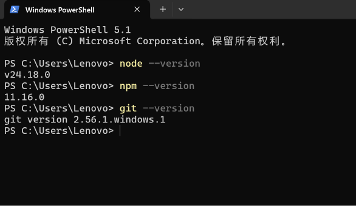

版本号的依据不是截图推测：根 `package.json` 第 69–71 行明确写了 `"engines": { "node": ">=22.19.0" }`，本次用的 v24.18.0 高于该下限，因此安装阶段没有出现 `EBADENGINE`。

## 二、任务二 下载课程仓库源码

小组组织仓库为课程仓库的 fork，地址 `https://github.com/superheror/pi-hunnu-2026`，在 `practice/02-Pi-Agent-fork` 目录下执行：

```bash
git clone --branch main https://github.com/superheror/pi-hunnu-2026
cd pi-hunnu-2026
```

克隆输出显示 `Receiving objects: 100% (110072/110072), 106.76 MiB`，随后 `Updating files: 100% (4613/4613)`。

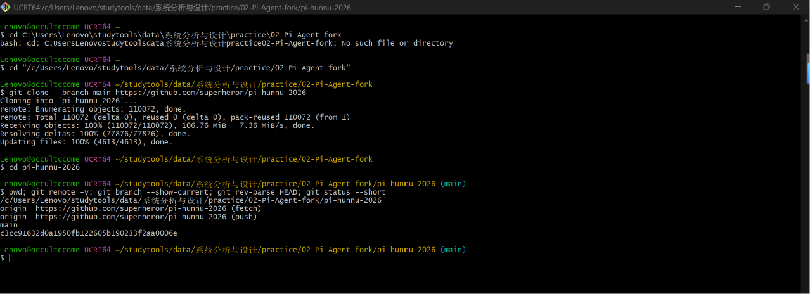

在仓库根目录执行 `pwd`、`git remote -v`、`git branch --show-current`、`git rev-parse HEAD`、`git status --short`，得到：

- 当前目录：`/c/Users/Lenovo/studytools/data/系统分析与设计/practice/02-Pi-Agent-fork/pi-hunnu-2026`
- `origin`：fetch 与 push 均指向 `https://github.com/superheror/pi-hunnu-2026`（不是教师组织仓库，说明用的是组内 fork）
- 当前分支：`main`
- 提交编号：`c3cc91632d0a1950fb122605b190233f2aa0006e`
- `git status --short` 无输出，说明克隆后工作区干净

## 三、任务三 阅读配置，确认安装与编译的依据

用 VS Code 打开仓库根目录，逐项核对：

| 文件或目录 | 实际观察到的内容 |
|---|---|
| `README.md` | `Development` 一节给出 `npm install --ignore-scripts`、`npm run build`、`npm run build:offline`、`npm run check`、`./test.sh`、`./pi-test.sh` 六条命令 |
| `package.json` | `engines.node` 为 `>=22.19.0`；`workspaces` 为 `packages/*`、`apps/*` 加 4 个示例目录；`scripts.build` 是一条 `&&` 串行链；`devDependencies` 全部为精确版本（`typescript 7.0.2`、`esbuild 0.28.2`、`@biomejs/biome 2.3.5`、`husky 9.1.7` 等） |
| `package-lock.json` | 约 207 KB，锁定依赖版本与依赖关系；安装时以它为准 |
| `packages/` | 12 个子包：`telemetry`、`schema`、`chord`、`tui`、`codemode`、`mcp`、`ai`、`durable`、`env`、`agent`、`coding-agent`、`evals` |
| `packages/coding-agent/package.json` | 版本 1.5.2；`bin.pi` 指向 `dist/bundle/cli.js`；`scripts.build` 为 `build:unbundled` 再执行根目录的 `scripts/build-coding-agent-bundle.mjs` |

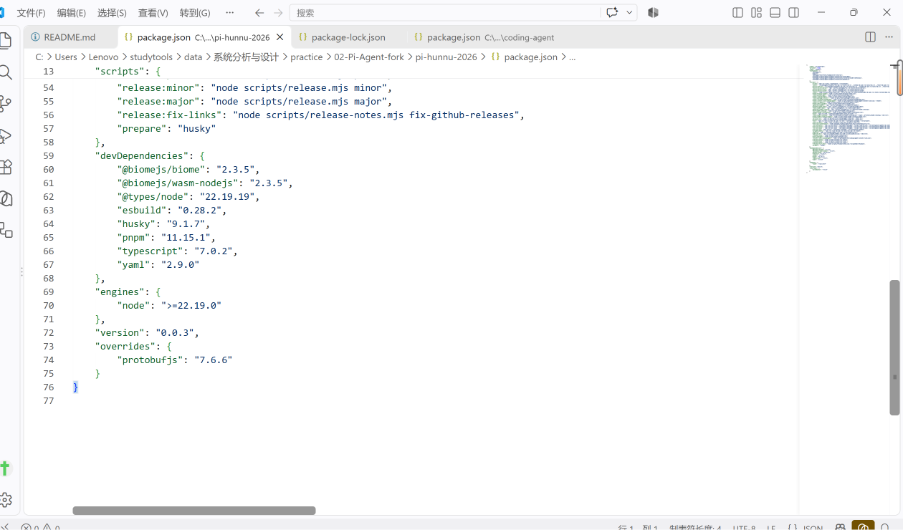

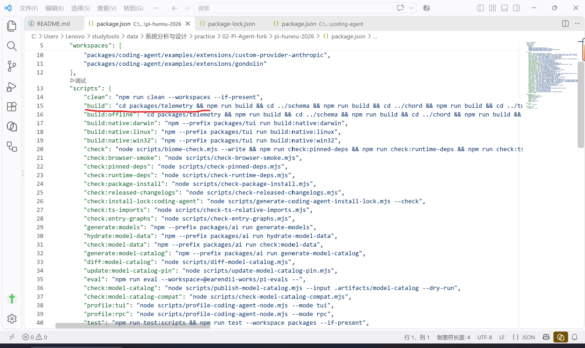

`scripts.build` 的实际内容（节选，`&&` 表示前一步成功后继续）：

```
cd packages/telemetry && npm run build && cd ../schema && npm run build && cd ../chord && npm run build
&& cd ../tui && npm run build && cd ../codemode && npm run build && cd ../mcp && npm run build
&& cd ../ai && npm run build && cd ../durable && npm run build && cd ../env && npm run build
&& cd ../agent && npm run build && cd ../coding-agent && npm run build
```

**问题一：Node.js 版本要求在哪里？**
在仓库根 `package.json` 的 `engines.node`（第 69–71 行）里，值是 `>=22.19.0`。它不是写在 README 的一句话里，也不是由截图里的版本反推出来的；README 第 43 行只说“需要 Node.js 22.19 或更新”，属于对同一事实的复述。

**问题二：`npm run build` 实际从哪里读取命令？**
npm 本身不知道任何项目的编译流程，它只读取当前目录 `package.json` 的 `scripts.build` 字段，把该字段的值当作一条 shell 命令执行。这条命令是一条手写的串行链：先用 `cd` 进入子包，再执行该子包 `package.json` 里自己的 `scripts.build`。所以真正的编译动作（例如 `tsc -p tsconfig.build.json`）定义在 11 个子包的 `package.json` 中，根脚本只负责顺序调度；某个子包没有 `build` 加 `--if-present` 也不会静默跳过，这条链是显式点名每个包的。

## 四、任务四 安装项目依赖

在仓库根目录（能同时看到 `package.json`、`package-lock.json`、`pi-test.bat` 的那一层）执行：

```powershell
npm install --ignore-scripts
echo "exit=$LASTEXITCODE"
```

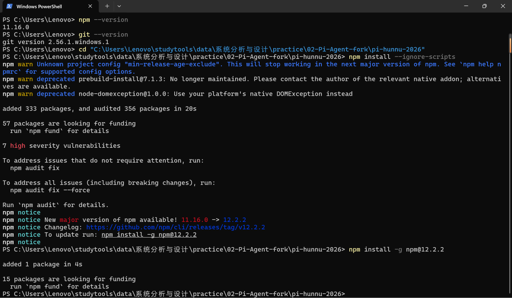

安装结果的真实记录：

- `added 333 packages, and audited 356 packages in 2s`
- `57 packages are looking for funding`
- 结尾提示存在 high severity 漏洞，并给出 `npm audit fix` 与 `npm audit fix --force` 两条建议
- npm 自身提示有新版本，随后执行了 `npm install -g npm@12.2.2`（`added 1 package in 4s`）

**这条命令做了什么（四点）：**

1. 依据 `package.json` 与 `package-lock.json` 解析依赖图并下载安装；锁文件与声明一致时使用锁定版本，因此不同机器装出的版本可复现。
2. 在根目录建立 `node_modules`，并按 `workspaces` 把 12 个子包以符号链接方式关联进去，子包之间互相引用不经过网络，也不各自生成新的锁文件。
3. 安装编译期需要的工具，例如 `typescript`、`esbuild`，它们只在构建时使用。
4. `--ignore-scripts` 跳过 `postinstall`、`prepare` 等生命周期脚本（本仓库根 `scripts.prepare` 是 `husky`，用于安装 Git 钩子）。跳过它不影响后面主动执行的 `npm run build`，也符合仓库自身文档与安全约定。

命令没有 `-g`，安装的是项目本地依赖，不会把本地修改后的 Pi 装成全局 `pi` 命令。

**警告分类（截图 S4 中逐条出现）：**

| 输出 | 类别 | 是否影响本次实验 |
|---|---|---|
| `npm warn Unknown project config "min-release-age-exclude"` | 配置警告：仓库内 `.npmrc` 的这个键当前 npm 版本不识别 | 不影响安装；不修改仓库配置，仅在报告中记录 |
| `deprecated prebuild-install@7.1.3`、`deprecated node-domexception@1.0.0` | 依赖弃用提示，属于传递依赖 | 不影响构建；不手动改版本，避免破坏锁定树 |
| `high severity vulnerabilities` | 依赖树的安全审计结果 | 记录并分析；**没有**执行 `npm audit fix --force`，因为它会改动课程锁定的依赖版本 |

没有出现 `EBADENGINE`，原因见任务一：Node.js v24.18.0 高于 `>=22.19.0` 的要求。

## 五、任务五 本地编译与构建产物验证

### 1. 首次构建（需要联网）

```powershell
npm run build
echo "exit=$LASTEXITCODE"
```

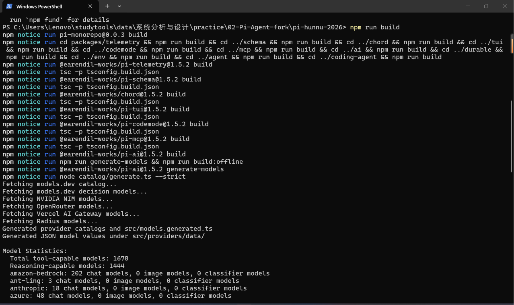

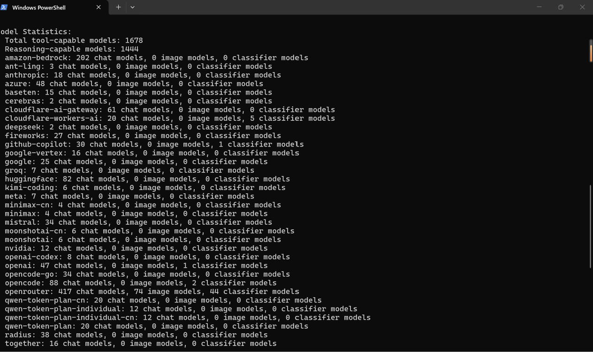

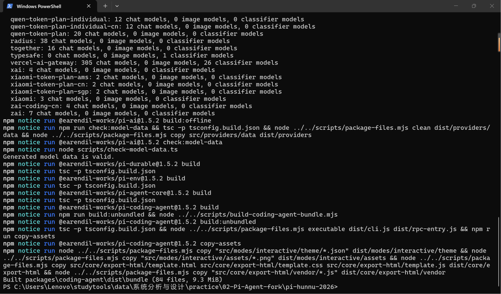

构建过程可分成三段，正好对应“根构建脚本 → 子包构建脚本 → 编译器或生成脚本”的调用关系：

1. `npm notice run pi-monorepo@0.0.3 build` 打印出整条 `cd ... && npm run build` 链，然后按 `telemetry → schema → chord → tui → codemode → mcp → ai → durable → env → agent → coding-agent` 顺序进入各包；每进入一个包都会打印 `npm notice run @earendil-works/包名@1.5.2 build` 及其真实命令（九个包都是 `tsc -p tsconfig.build.json`）。
2. `pi-ai` 是唯一联网络的一步：`generate-models` 依次 `Fetching models.dev catalog`、`Fetching models.dev decision models`、`Fetching NVIDIA NIM models`、`Fetching OpenRouter models`、`Fetching Vercel AI Gateway models`、`Fetching Radius models`，生成 `src/models.generated.ts` 与 `src/providers/data/` 下的 JSON。统计输出为 `Total tool-capable models: 1678`、`Reasoning-capable models: 1444`，并逐 provider 打印数量（如 `openrouter: 917 chat models, 74 image models`、`vercel-ai-gateway: 305 chat models, 26 classifier models`、`amazon-bedrock: 202 chat models`）。
3. `pi-ai` 的 `build:offline` 接着执行 `check:model-data`（输出 `Generated model data is valid.`）与 `tsc`，再把 `src/providers/data` 拷进 `dist/providers`；最后 `coding-agent` 走 `build:unbundled` 加 `build-coding-agent-bundle.mjs`，产出 `dist/bundle/cli.js`。

这里联网拿到的只是模型目录、能力等配置数据，不是大模型权重；本地客户端构建与模型推理服务是两件不同的事。

### 2. 检查并运行构建产物

```powershell
Test-Path .\packages\coding-agent\dist\bundle\cli.js
node .\packages\coding-agent\dist\bundle\cli.js --version
```

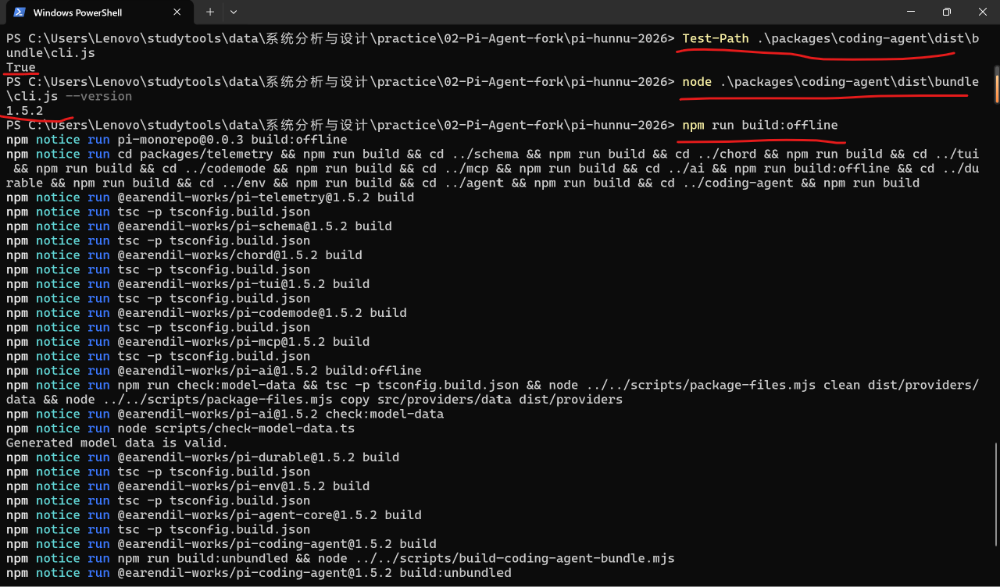

- `npm run build` 以退出码 0 结束（`echo` 输出的 `exit=0`）；
- `Test-Path` 输出 `True`，说明入口文件确实存在；
- `node .\packages\coding-agent\dist\bundle\cli.js --version` 输出 `1.5.2`，与 `packages/coding-agent/package.json` 的 `version` 一致；
- 之后又执行了一次 `npm run build:offline`，日志中 `pi-ai` 那一步变成 `npm run build:offline`，不再有 `Fetching ... models` 的网络访问，其余包的 `tsc` 重新执行。

结论：11 个子包全部构建成功，而不是只有某一个包成功；只有版本号能输出，也不能单独证明本次构建成功，所以三项证据（退出码、`Test-Path`、版本号）一起记录。

`dist` 里放的是构建产物。以后修改程序应当改 `src` 下的源码再重新构建，直接改 `dist` 会在下次构建时被覆盖。

## 六、任务六 启动本地源码版本并完成一次会话

### 1. 先验证源码入口

```powershell
.\pi-test.bat --version
```

名字里带 `test`，但这不是执行测试套件：`pi-test.bat` 只负责调用 `pi-test.ps1`（`powershell.exe -NoProfile -ExecutionPolicy Bypass -File pi-test.ps1`），后者用 `node --import <source-resolver.ts> packages/coding-agent/src/cli.ts` 直接加载 TypeScript 源码运行。也就是说这条路完全不经过 `dist`。

### 2. 启动交互界面

```powershell
.\pi-test.bat
```

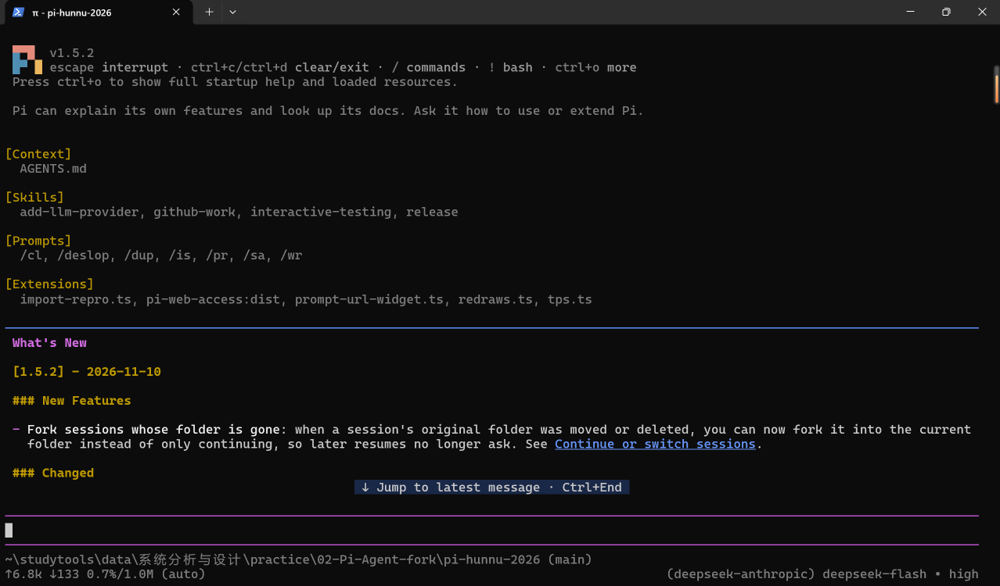

界面标题为 `pi-hunnu-2026 v1.5.2`，底部状态栏显示工作目录为 `...\practice\02-Pi-Agent-fork\pi-hunnu-2026`、分支 `(main)`、模型 `deepseek-anthropic / deepseek-flash / high`。启动时加载了仓库内的 `AGENTS.md`、四个 skills、六个 prompts 和三个扩展；`What's New [1.5.2] - 2026-11-10` 说明运行的是这次的 1.5.2 版本。

本地源码版与已安装的 Pi 共用 `~/.pi/agent` 配置目录，因此第一次实践课登录过的账户可以直接使用，无需再次 `/login`。这只表示复用了凭据，不表示运行的是全局安装版本。

发送的提示词：

```text
请用一句话说明源码和编译产物的区别。只回答问题，不修改文件。
```

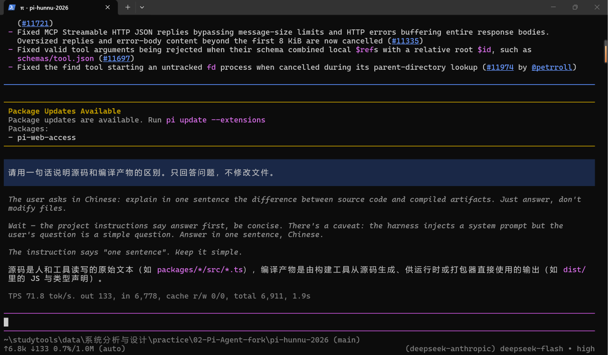

模型实际回复：

> 源码是人和工具读写的原始文本（如 `packages/*/src/*.ts`），编译产物是由构建工具从源码生成、供运行时或打包器直接使用的输出（如 `dist/` 里的 JS 与类型声明）。

状态栏同时给出本轮用量：`out 133`、`in 6,778`、`TPS 71.8 tok/s`。模型没有修改任何文件，符合提示词约束。

### 3. 退出与对照

按 `/quit` 回车退出（界面上 `ctrl+c/ctrl+d` 也标注为 clear/exit，输入框为空时 `ctrl+d` 可直接退出），回到 PowerShell 后运行编译产物做对照：

```powershell
node .\packages\coding-agent\dist\bundle\cli.js
```

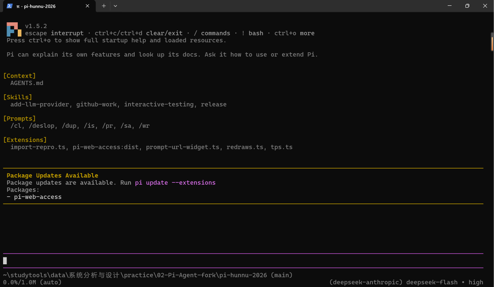

## 七、遇到的困难与解决过程（重点）

**困难 1：中文路径导致 Git Bash 的 `cd` 失败。**
现象：先执行 `cd c:\users\Lenovo\studytools\data\系统分析与设计\practice\02-Pi-Agent-fork`，Git Bash 报 `bash: cd: ...: No such file or directory`。
原因：反斜杠在 Bash 里是转义字符，路径被拆坏了；另外 MSYS 需要 `/c/...` 形式的路径。
解决：改用引号包裹的 POSIX 路径 `cd "/c/Users/Lenovo/studytools/data/系统分析与设计/practice/02-Pi-Agent-fork"`，之后 `pwd` 输出正常。这也是为什么后续安装与构建改到 PowerShell 里做——PowerShell 对反斜杠和中文目录都不敏感，`Test-Path`、`$LASTEXITCODE` 等命令也能直接用于截图要求。

**困难 2：`npm warn Unknown project config "min-release-age-exclude"`。**
现象：`npm install` 一开始就报这条警告。
原因：仓库根目录的 `.npmrc` 写了 `save-exact=true`、`min-release-age=2` 和 `min-release-age-exclude[]=@earendil-works/*`，当前 npm 版本不认识最后这个键。
判断：这是配置键警告，不是安装失败，命令继续执行并最终 `added 333 packages`。
处理：不改仓库 `.npmrc`（它是被 git 跟踪的项目配置），只在报告中记录，并注意该键在 npm 下一个主版本会彻底失效。

**困难 3：弃用与漏洞提示怎么处理。**
现象：`deprecated prebuild-install@7.1.3`、`deprecated node-domexception@1.0.0`，以及 high severity 漏洞计数。
判断：前两条来自传递依赖，属于“包已不再维护”的提示；漏洞计数是依赖树审计结果，两者都不等于安装失败。
处理：没有照提示执行 `npm audit fix --force`。理由是该命令会按 semver 范围强行升级，可能把 `package-lock.json` 里锁定、课程构建依赖的版本改掉，导致 `npm run build` 行为发生变化。本次只在报告中记录审计结论。

**困难 4：首次构建必须联网，失败点不在根脚本。**
现象：如果网络不可用，构建会在第 7 个包 `pi-ai` 的 `generate-models` 处失败，前面的 `tsc` 都已经成功，容易误判为“构建没问题，只是某个包慢”。
原因：`npm run build` 对 `ai` 用的是 `build`（`generate-models && build:offline`），需要从 models.dev 等来源抓目录数据；对应根脚本里 `build:offline` 才把这步换成不联网的 `build:offline`。
解决：联网重新执行 `npm run build`；首次成功后，后续重复构建改用 `npm run build:offline`（S5-4 中已复跑验证，日志里不再出现 `Fetching` 行）。这也说明“某个子包成功不能代表根构建成功”。

**困难 5：安装过程中 npm 自身的版本提示。**
现象：`npm install` 结束后 npm 提示可升级到 12.2.2，随后执行了 `npm install -g npm@12.2.2`。
影响：全局 npm 被替换，终端里之后执行的 `npm` 变成 12.2.2；本次实验的构建命令在两个版本下都执行成功。
经验：这类“顺手升级工具链”的操作应当单独记录，否则报告里 S1 的 11.16.0 与后续日志对不上。

## 八、结论：如何确保运行的是本地源码，两个入口分别适合什么场景

**如何确认跑的是本地源码：**

1. 用 `pi-test.bat` 启动，而不是直接输 `pi`；后者会命中第一次实践课安装的全局命令，无法证明来源。
2. 该脚本经 `pi-test.ps1` 用 `node --import <source-resolver.ts>` 直接加载 `packages/coding-agent/src/cli.ts`，运行路径中不出现 `dist`。
3. 底部状态栏显示的目录是本地仓库根目录、分支为 `(main)`，标题带 `v1.5.2`，与本次克隆的提交一致。
4. 另有一份独立证据：`node .\packages\coding-agent\dist\bundle\cli.js --version` 同样输出 `1.5.2`，说明源码版本与本地构建产物版本对应。
5. 共用 `~/.pi/agent` 只影响凭据与配置，不影响“哪个程序在执行”。

**两个入口的适用场景：**

| 入口 | 执行的是 | 适合场景 | 不适合 |
|---|---|---|---|
| `pi-test.bat` → `src/cli.ts` | 源码（经 TypeScript 源码解析器实时加载） | 开发调试：改 `src` 后直接重启即可生效，不需要先构建；排查源码级问题时能看到完整模块边界 | 分发、性能基准、验证发布包 |
| `node dist/bundle/cli.js` | 构建产物（esbuild 打包后的单文件 + chunks） | 验证本次构建是否成功、与用户实际安装的形态对齐、性能对比 | 改了源码却没重新 `npm run build` 时会运行旧逻辑 |

## 附：截图清单

| 编号 | 文件 | 内容 |
|---|---|---|
| S1 | `03-Pi-Agent-source-build-zhangjiayao/S1.png` | node v24.18.0、npm 11.16.0、git 2.56.1.windows.5.1 |
| S2 | `03-Pi-Agent-source-build-zhangjiayao/S2.png` | 克隆过程、目录、远端、分支、提交编号、`git status` |
| S3-1 | `03-Pi-Agent-source-build-zhangjiayao/S3-1.png` | `engines.node` 与 `devDependencies` |
| S3-2 | `03-Pi-Agent-source-build-zhangjiayao/S3-2.png` | `scripts.build` 的 `&&` 串行链 |
| S4 | `03-Pi-Agent-source-build-zhangjiayao/S4.png` | `npm install --ignore-scripts` 的警告、汇总与审计 |
| S5-1 | `03-Pi-Agent-source-build-zhangjiayao/S5-1.png` | 构建开始、子包 `tsc`、ai 抓模型目录 |
| S5-2 | `03-Pi-Agent-source-build-zhangjiayao/S5-2.png` | 模型目录统计（一） |
| S5-3 | `03-Pi-Agent-source-build-zhangjiayao/S5-3.png` | 模型目录统计（二）、`check:model-data`、后续包构建 |
| S5-4 | `03-Pi-Agent-source-build-zhangjiayao/S5-4.png` | 产物检查、`--version` 输出 1.5.2、`build:offline` 复跑 |
| S6-1 | `03-Pi-Agent-source-build-zhangjiayao/S6-1.png` | `pi-test.bat` 启动的源码版界面 |
| S6-2 | `03-Pi-Agent-source-build-zhangjiayao/S6-2.png` | 自己的提示词与模型实际回复 |
| S6-3 | `03-Pi-Agent-source-build-zhangjiayao/S6-3.png` | 版本号与终端上下文 |
