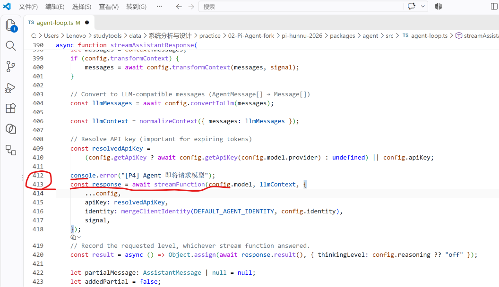
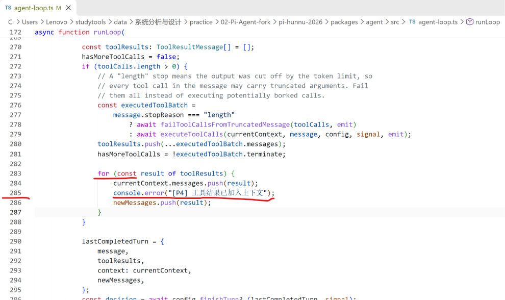
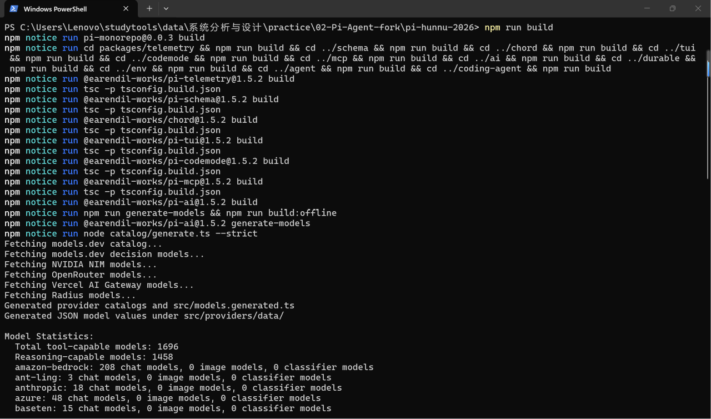
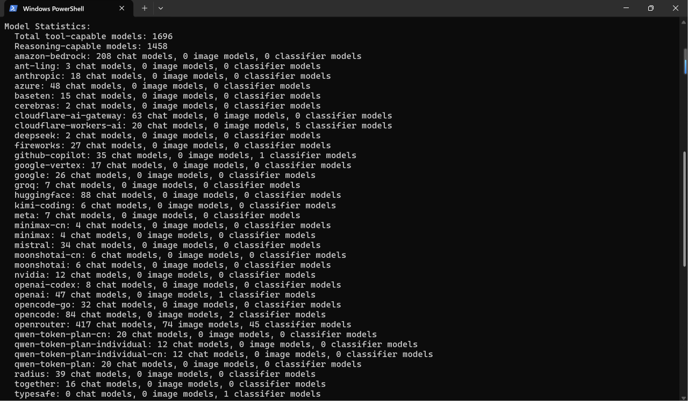
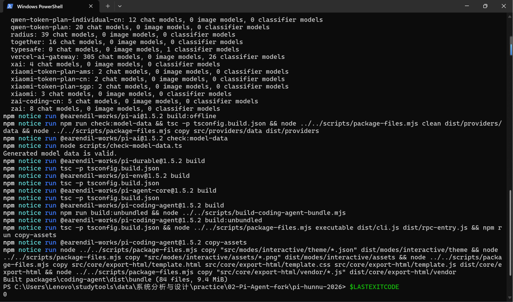

# 实践课4：Pi Agent 的模型调用与运行流程（zhangjiayao）

## 基本信息
- GitHub 登录名：occultccome

## 作业链接
- 个人作业地址：https://github.com/occultccome/pi-practice/blob/main/practice-04.md
- 小组组织仓库：https://github.com/superheror/pi-hunnu-2026
- 代码提交编号：c3cc91632d0a1950fb122605b190233f2aa0006e


## 补充说明
无

## 一、任务一：给 Agent 循环加两行日志

修改的文件是 `packages/agent/src/agent-loop.ts`，只加两行 `console.error`，不改任何逻辑。



位置一（原第 412 行，本次落在第 413 行附近）：在真正发起模型请求之前。

```ts
console.error("[P4] Agent 即将请求模型"); // 新增
const response = await streamFunction(config.model, llmContext, {
```

这一行在 `streamFunction` 上方，所以每“进入一轮模型调用”就打印一次；它记录的是 Agent 决定把当前上下文交给模型的时刻，而不是模型返回的时刻。



位置二（原第 284 行，本次落在第 285–287 行）在 `for (const result of toolResults)` 循环内、`currentContext.messages.push(result)` 之后：

```ts
for (const result of toolResults) {
    currentContext.messages.push(result);
    console.error("[P4] 工具结果已加入上下文"); // 新增
    newMessages.push(result);
}
```

它写在 `push` 之后而不是 `for` 之前，含义才准确：此时这一条工具结果**已经进入**上下文，下一步循环会把它一起发给模型。写在 `for` 外面会得到“每条工具结果都只打印一次”的假象，实际工具轮次一多，两者就对不上。

## 二、任务二：重新编译并启动

保存源码后，在仓库根目录（有根 `package.json` 的那一层）执行：

```powershell
npm run build
$LASTEXITCODE
```







构建过程的实际情况：

1. `npm notice run pi-monorepo@0.0.3 build` 打出整条 `cd ... && npm run build` 链，然后按 `telemetry → schema → chord → tui → codemode → mcp → ai → durable → env → agent → coding-agent` 顺序执行，每个子包都打印自己的 `tsc -p tsconfig.build.json`。
2. 第 7 个包 `pi-ai` 先跑 `generate-models`：依次 `Fetching models.dev catalog`、`models.dev decision models`、`NVIDIA NIM models`、`OpenRouter models`、`Vercel AI Gateway models`、`Radius models`，输出 `Generated provider catalogs and src/models.generated.ts` 与 `Generated JSON model values under src/providers/data/`。
3. 统计结果：`Total tool-capable models: 1696`、`Reasoning-capable models: 1458`；逐 provider 数量例如 `amazon-bedrock: 208`、`anthropic: 18`、`openai: 47`、`openrouter: 917 chat models, 74 image models, 45 classifier models`、`vercel-ai-gateway: 305 chat, 26 classifier`、`radius: 39`。
4. `pi-ai` 接着执行 `build:offline`：先 `check:model-data` 输出 `Generated model data is valid.`，再 `tsc`，最后把 `src/providers/data` 复制到 `dist/providers`。
5. `coding-agent` 走 `build:unbundled` + `build-coding-agent-bundle.mjs`，最后一行是 `Built packages\coding-agent\dist\bundle (84 files)`，随后回到提示符，`$LASTEXITCODE` 输出 **0**。

**关于这一步里“编译”到底做了什么**：根脚本只负责顺序调度，真正的编译发生在各子包的 `tsc` 里；只有 `packages/ai` 额外多了一步“从上游刷新模型目录数据”，这也是整个构建里唯一需要联网的地方。

构建结束后启动编译产物：

```powershell
node .\packages\coding-agent\dist\cli.js
```

![S4 编译产物启动的 Pi 界面与 [P4] 日志](04-Pi-Agent-run-zhangjiayao/S4.png)

界面标题为 `pi-hunnu-2026 v1.5.2`，底部状态栏显示工作目录为仓库根目录、分支 `(main)`、模型 `(deepseek-anthropic) deepseek-flash`（high）。启动时会加载 `AGENTS.md`、四个 skills（add-lim-provider、github-work、interactive-testing、release）、prompts（/ct、/deslop、/dup、/ls、/pr、/sa、/wr）和五个扩展（import-repro.ts、pi-web-access:dist、prompt-url-widget.ts、redraws.ts、tps.ts），加载过程本身会触发工具调用，所以在还没有输入任何指令时，界面里就已经能看到 `[P4] 工具结果已加入上下文` 和紧随其后的 `[P4] Agent 即将请求模型`——这两类日志成对出现的位置，正是后面要观察的循环后半段。

## 三、任务三：对比两次运行

在仓库根目录创建 `practice4.txt`，写入一行实验代号（本次为 `7`）。两次会话都新开、使用同一模型 `deepseek-flash`。

### 3.1 会话 A：直接问答

指令：

```text
请直接用一句话解释什么是 Git 分支。
```

![S5 会话 A 的指令、回复与 [P4] 日志](04-Pi-Agent-run-zhangjiayao/S5.png)

- 是否调用工具：**没有**，界面里没有任何工具调用的痕迹。
- `[P4]` 日志：只出现 **1 条** `[P4] Agent 即将请求模型`，没有任何 `[P4] 工具结果已加入上下文`。
- 最终回复（原文）：

> 分支本质上只是一个指向某次提交的可移动指针，即一条轻量的引用；你可以在它上面独立提交改动，而不影响其他分支。

- 本轮用量：`TPS 78.0 tok/s`、`out 110`、`in 291`、`cache r/w 6,528/0`、`total 6,879`。
- 结论：全程 **1 轮模型调用**。问题是纯知识性的，模型凭已有参数即可回答，循环在一次“请求—回答”后结束。

### 3.2 会话 B：读取文件

指令：

```text
请用 read 工具读取当前目录的 practice4.txt，并告诉我文件中的实验代号。
```

![S6 会话 B 的指令、read 工具调用与 [P4] 日志](04-Pi-Agent-run-zhangjiayao/S6.png)

- 是否调用工具：**是**，界面里能看到 `read` 读取 `practice4.txt` 的记录，模型先说了一句 `Let me try reading the file.` 才发起工具调用。
- `[P4]` 日志的完整顺序：

```text
[P4] Agent 即将请求模型
[P4] 工具结果已加入上下文
[P4] Agent 即将请求模型
```

截图底部可清晰辨认出后两条（`工具结果已加入上下文` 与紧随其后的 `Agent 即将请求模型`），第一条（本轮请求）随界面刷新滚到了上方。
- 最终回复（原文）：

> 文件 practice4.txt 的内容：实验代号为 7。

- 本轮用量：`TPS 37.8 tok/s`、`out 63`、`in 928`、`cache r/w 13,440/0`、`total 13,931`。
- 结论：**2 轮模型调用**。第一轮模型决定调用工具但没有足够信息回答；工具执行完把结果写回上下文后，第二轮模型才给出最终答案。

### 3.3 两次对比与“谁读了文件”

| 对比项 | 会话 A（直接问答） | 会话 B（读取文件） |
|---|---|---|
| 输入指令 | 请直接用一句话解释什么是 Git 分支。 | 请用 `read` 工具读取当前目录的 `practice4.txt`，并告诉我文件中的实验代号。 |
| 是否调用工具 | 否 | 是（`read`） |
| `[P4]` 日志 | 1 条“即将请求模型” | “即将请求模型” → “工具结果已加入上下文” → “即将请求模型” |
| 模型调用轮数 | 1 轮 | 2 轮 |
| 最终回复 | Git 分支定义（未触碰本地文件） | 实验代号 7 |

**谁实际读了文件？** 不是模型。模型只是发出了一个“调用 `read` 工具、参数为 `practice4.txt`”的请求；真正打开文件、读取字节的是本地运行的 `coding-agent` 里的工具实现。模型所在的服务端没有、也不需要访问这个文件——这也解释了为什么 `practice4.txt` 的内容必须“回灌”进上下文，模型才可能知道代号是 7。

**下一轮模型请求多带了什么？** 多了一条工具结果消息（role 为 tool 的结果项），里面装着 `practice4.txt` 的文本内容。`[P4] 工具结果已加入上下文` 打印在 `currentContext.messages.push(result)` 之后，紧接着出现的 `[P4] Agent 即将请求模型` 就是这一轮带上了新消息的请求。所以两条日志的相邻关系，正是“工具结果进入上下文 → 立刻再次请求模型”这条链路在日志上的显影；而会话 A 里缺少这对相邻日志，也就缺了整段后半循环。

### 3.4 调用链路简图

```text
        用户输入（TUI）
              │
              ▼
  ┌───────────────────────────┐
  │ packages/coding-agent     │  dist/cli.js：交互界面、工具实现（read/write/bash…）
  │                           │  AGENTS.md、skills、扩展在此加载
  └───────────┬───────────────┘
              │  组装上下文、注册工具
              ▼
  ┌───────────────────────────┐
  │ packages/agent            │  agent-loop.ts：模型调用循环
  │  [P4] Agent 即将请求模型  │  ← 日志 1：每轮请求前
  │  [P4] 工具结果已加入上下文 │  ← 日志 2：每条工具结果写回后
  └───────────┬───────────────┘
              │  streamFunction(model, llmContext)
              ▼
  ┌───────────────────────────┐
  │ packages/ai (pi-ai)       │  统一 LLM 调用层：请求构造、SSE 流解析、重试
  └───────────┬───────────────┘
              │  HTTPS（流式）
              ▼
  ┌───────────────────────────┐
  │ 远程模型服务               │  deepseek-anthropic / deepseek-flash
  └───────────────────────────┘
```

## 附：截图清单

| 编号 | 文件 | 内容 |
|---|---|---|
| S1 | `04-Pi-Agent-run-zhangjiayao/S1.png` | `agent-loop.ts` 中 `streamFunction` 前的 `[P4] Agent 即将请求模型` |
| S2 | `04-Pi-Agent-run-zhangjiayao/S2.png` | `for (const result of toolResults)` 内 `push(result)` 后的 `[P4] 工具结果已加入上下文` |
| S3-1 | `04-Pi-Agent-run-zhangjiayao/S3-1.png` | `npm run build` 开始、子包构建链、模型目录抓取 |
| S3-2 | `04-Pi-Agent-run-zhangjiayao/S3-2.png` | 各 provider 模型数量统计 |
| S3-3 | `04-Pi-Agent-run-zhangjiayao/S3-3.png` | `check:model-data` 通过、bundle 产出、`$LASTEXITCODE` 为 0 |
| S4 | `04-Pi-Agent-run-zhangjiayao/S4.png` | `node .\packages\coding-agent\dist\cli.js` 打开的界面与启动期 `[P4]` 日志 |
| S5 | `04-Pi-Agent-run-zhangjiayao/S5.png` | 会话 A：指令、最终回复、1 条 `即将请求模型` 日志 |
| S6 | `04-Pi-Agent-run-zhangjiayao/S6.png` | 会话 B：指令、`read` 读取 `practice4.txt`、代号回复、两类日志 |
