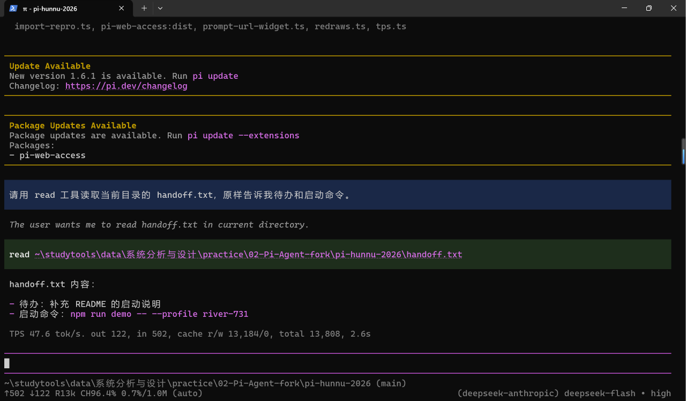
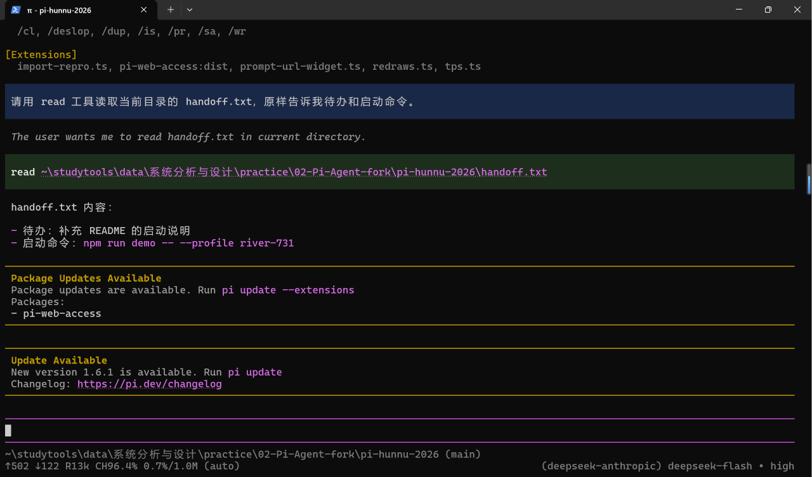
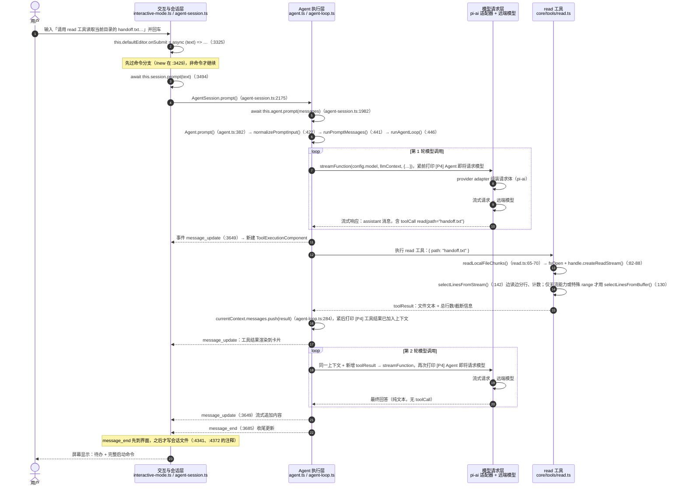
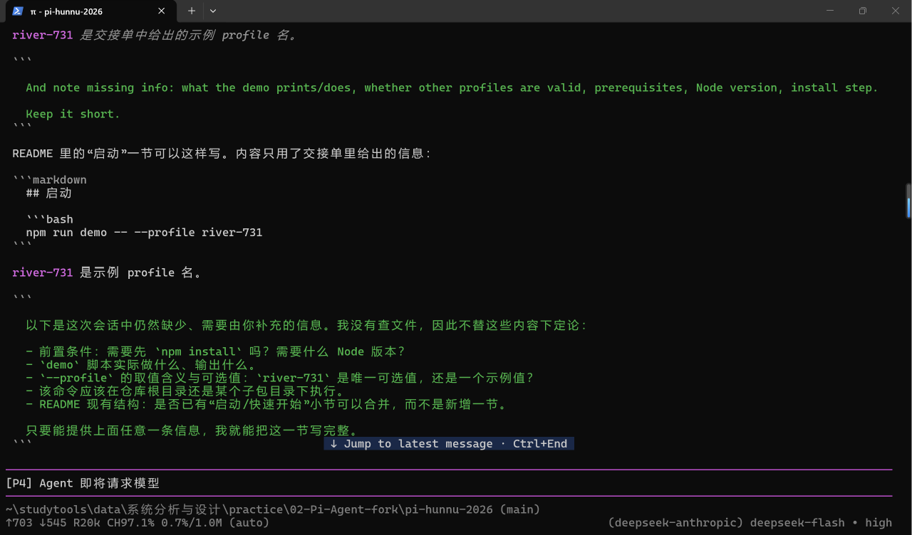
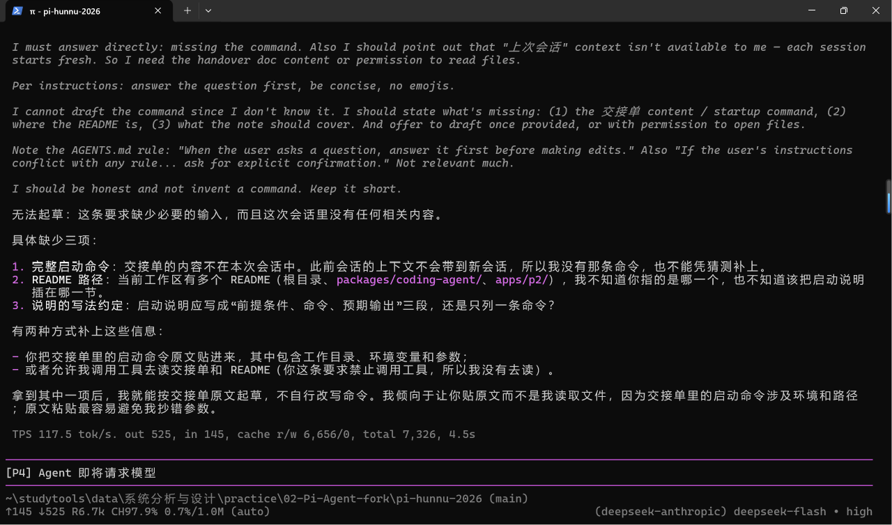
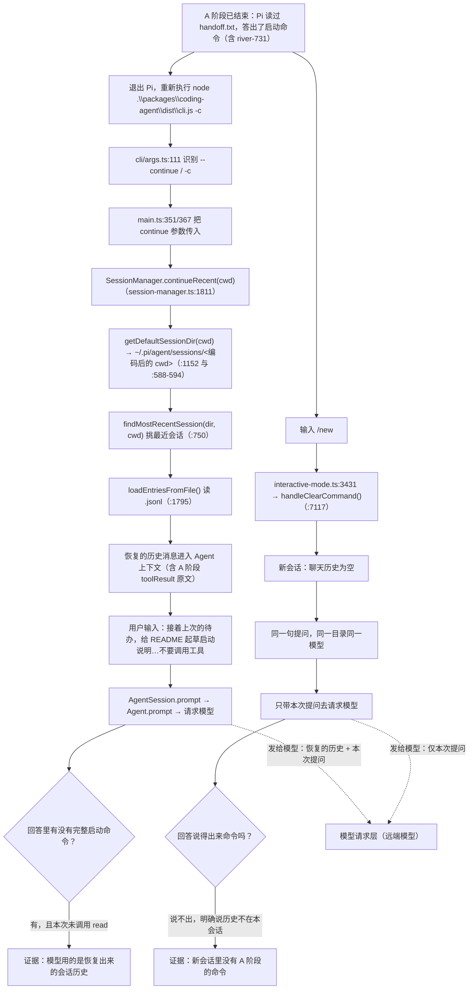

# 实践课5：Pi Agent 源码泛读与功能定位（zhangjiayao）

## 基本信息

- GitHub 登录名：occultccome

## 作业链接

- 个人作业地址：https://github.com/occultccome/pi-practice/blob/main/practive-05.md
- 小组组织仓库：https://github.com/superheror/pi-hunnu-2026
- 提交编号：c3cc91632d0a1950fb122605b190233f2aa0006e

## 补充说明
无
## 一、A 阶段：单轮交互与一次 read 工具调用

在仓库根目录创建 `handoff.txt`，两行内容：

```text
待办：补充 README 的启动说明
启动命令：npm run demo -- --profile river-731
```

启动本地构建的 Pi，在新会话中输入：

```text
请用 read 工具读取当前目录的 handoff.txt，原样告诉我待办和启动命令。
```





观察到的事实：

- `read` 工具**确实执行了一次**，参数路径是 `...\practice\02-Pi-Agent-fork\pi-hunnu-2026\handoff.txt`，界面把文件内容原样回显为“handoff.txt 内容”；
- 模型回复把两行原样带出，包含 `npm run demo -- --profile river-731`，说明命令来自文件而不是提示词；
- 这一轮用量：`TPS 47.6 tok/s`、`out 122`、`in 502`、缓存读 13,184 / 写 0、`total 13,808`，缓存命中率 96.4%；
- 状态栏 cwd 为仓库根、分支 `(main)`、模型 `deepseek-anthropic / deepseek-flash / high`。

按源码，这一轮内部发生的是：一次用户输入 → 第 1 次模型调用（模型返回 `toolCall`）→ 执行 `read` → 工具结果写回上下文 → 第 2 次模型调用（基于工具结果生成回答）。图 1 画的就是这条路径。

### 图 1：单轮工具调用的代码级时序图



读图要点：`read` 工具那一层刻意分成两步——默认走 `createReadStream` 的**流式读取**，只有“调用方不提供 `createReadStream`”或“范围特殊（例如 `limit -1`）”时才退回 `selectLinesFromBuffer` 的**整文件缓冲读取**。这就是任务书要求核对的“实际是流式还是缓冲”的答案。

## 二、B 阶段：恢复旧会话与新建会话的对照

### 1. 恢复原会话（`-c`）

退出 Pi 后执行：

```powershell
node .\packages\coding-agent\dist\cli.js -c
```

启动后能看到 A 阶段的聊天记录，然后输入：

```text
接着上次的待办，给 README 起草一条启动说明，写出交接单里的完整启动命令。只用这次会话已有的信息。不要调用工具。如果缺少命令，请直接说明。
```



实际结果：

- **没有调用任何工具**（提示词也禁止了），终端只出现一条 `[P4] Agent 即将请求模型`，说明整轮只有 1 次模型调用；
- 回答里写出了完整命令 `npm run demo -- --profile river-731`，并明确标注“内容是仅用了交接单里给出的信息”。它没有重新读文件却能写出命令，唯一的来源就是恢复出来的会话历史（A 阶段那条 `toolResult`）；
- 它还主动列出了自己拿不到的信息（是否需要 `npm install`、`demo` 脚本做什么、`--profile` 是否只有 `river-731`、命令该在根目录还是子包执行），说明它引用的是“文件里写了什么”，而不是凭空补全。

### 2. 新建会话（`/new`）

同一目录、同一模型，输入 `/new` 后把**完全相同的一段话**再发一次。



实际结果：

- 同样没有调用工具，终端也只有一条 `[P4] Agent 即将请求模型`；
- 回答开头就是“无法起草：这条要求缺少必要的输入”，并给出理由：“**此前会话的上下文不会带到新会话**，所以我没有那条命令，也不能凭猜测补上”；
- 它列出三项缺失（完整启动命令、README 路径、说明的写法约定），并要求用户贴原文或允许读文件。

### 3. 两次对比

| 项目 | 恢复旧会话（`-c`） | 新建会话（`/new`） |
|---|---|---|
| 启动命令 | `node .\packages\coding-agent\dist\cli.js -c` | 同一进程内输入 `/new` |
| 是否调用工具 | 否 | 否 |
| [P4] 日志条数 | 1 条 | 1 条 |
| 是否答出 `river-731` 完整命令 | **是**，且注明只用了交接单信息 | **否**，明确说历史不在本会话 |
| 缓存命中率 | 97.1% | 97.9% |
| 结论 | 使用了从文件恢复的会话历史 | 历史为空，只能看到本次提问 |

这一对比符合任务书的判据：恢复后既写出了命令、又没有重新读文件，所以证据支持“它用的是恢复出的会话历史”，而不是又去读了一次文件。

### 图 2：恢复旧会话与新建会话的对照



读图要点：两条分支的差别不在模型、不在提示词，而在**送给模型的消息列表**。左边的列表由“从 `.jsonl` 恢复的历史 + 新提问”组成，右边的列表只有“新提问”。

## 三、结论

**谁实际读了文件？** 是 `read` 工具，具体执行路径是 `core/tools/read.ts` 里的 `readLocalFileChunks` → `createReadStream`，以流式方式分块读取并按行选择；模型本身没有文件系统能力，它只看到工具返回的文本。

**下一轮模型请求多带了什么？** A 阶段第 2 次请求比第 1 次多了一条 `toolResult` 消息（`currentContext.messages.push(result)`，即 `handoff.txt` 的正文）。这条消息随后被写进会话 `.jsonl`，所以 B 阶段用 `-c` 恢复时能再次出现在上下文里，而 `/new` 的清空会话里没有它——这就是两次回答分歧的全部原因。

**编码位置建议**：如果以后要改工具行为，改 `core/tools/read.ts`（工具实现）或 `agent-loop.ts`（循环与上下文写入）；要改会话恢复逻辑，改 `core/session-manager.ts` 的 `continueRecent` / `findMostRecentSession`。

